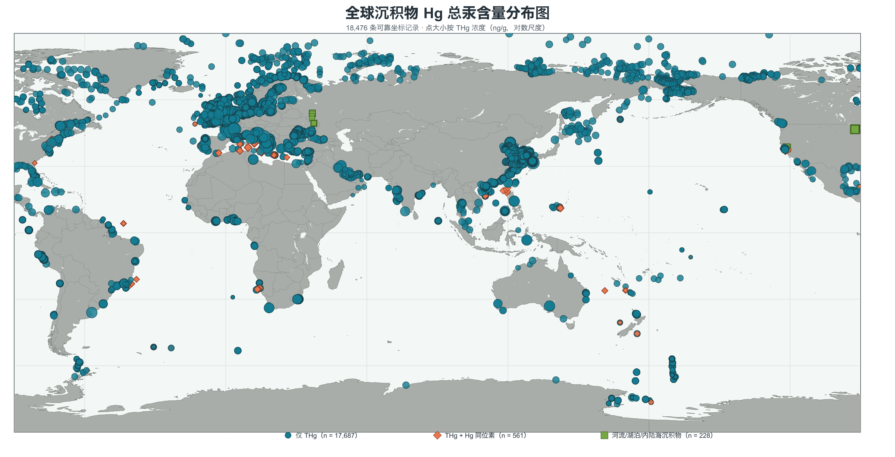
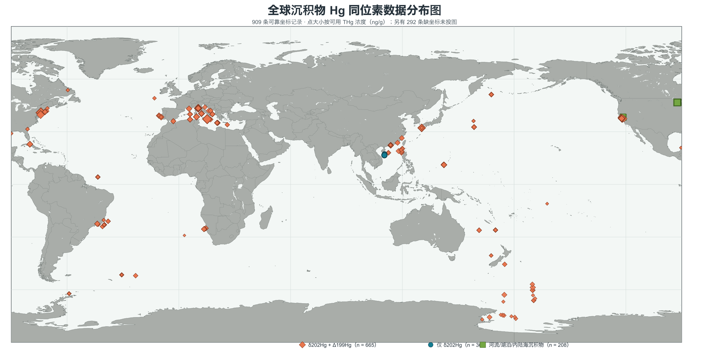
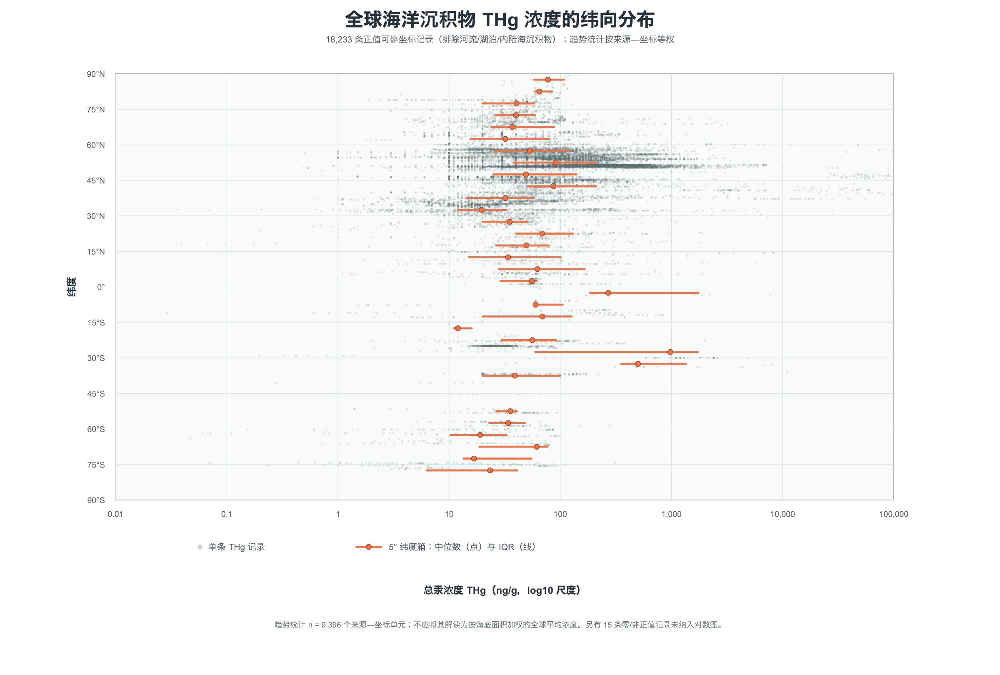
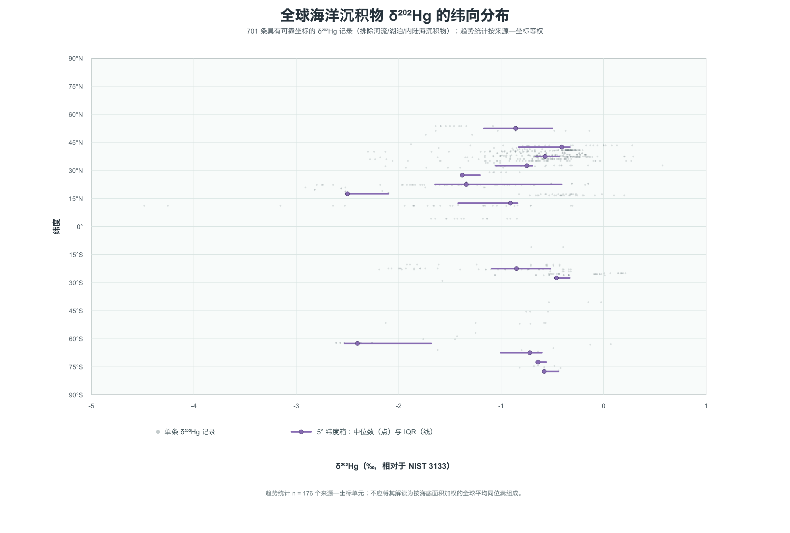

# 全球现代沉积物 Hg 地点覆盖地图

这是全球现代沉积物 Hg 数据库的公开可视化版本，仅用于查看地点覆盖。

## 查看与操作

- 地图地址：<https://karl0612.github.io/global-marine-hg-database/>。
- 悬停或点击圆点，可查看该地点名称、精确经纬度和样品数量。
- 拖动地图可平移；使用鼠标滚轮或触控板可放大、缩小。
- 右上角 `+`、`−` 用于缩放，`⌂` 回到初始视图，`⟲` 清除选择并恢复初始视图。
- 地图可向左右连续平移，以避免日期变更线附近的地点被切割。
- 地图下方的“数据新增历史”按本地数据库导入时段汇总新增样品数；可左右滑动查看，悬停或点击柱形即可高亮对应时段新增的地点。再次点击同一柱形、点击地图空白处或点击 `⟲` 可恢复全部地点。

## 公开范围

公开版仅保留地点、精确坐标和样品数量。它不包括站位身份、Hg 含量、Hg 同位素结果、样品编号、沉积类型、分析方法、文献、DOI、来源表或原始数据文件。

完整的整理数据库、文献来源文件和数据收集流程均保持私有。

## 图 1：当前数据库图件

以下 PNG 仅为当前公开图件预览；完整数据、文献来源和原始表格不随图件公开。

